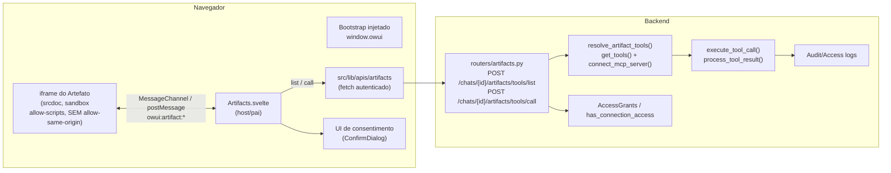

# Plano — Acesso de Artifacts às Tools e MCPs do usuário no Open WebUI

> **Status:** Proposta / Plano de implementação (fase inicial)
> **Fork:** https://github.com/gsbenevides2/open-webui
> **Branch proposta:** `feat/artifact-tools-mcp`
> **Base analisada:** `main` @ `0666e59d2` (2026-11-17)
> **Escopo do documento:** planejar **como** implementar; a implementação em código virá nas fases descritas na seção 10.

---

## 1. Resumo executivo

Hoje os **Artifacts** do Open WebUI são conteúdo estático extraído das respostas do modelo
(HTML/CSS/JS renderizados em um `<iframe sandbox>` ou SVG) e **não têm como chamar APIs,
Tools ou MCPs**. As **Tools** (Python customizado / OpenAPI) e os **MCP servers** só são
resolvidos e executados **server-side durante a geração da resposta do chat**.

A feature proposta dá às páginas de Artefato uma **ponte (bridge) segura e com consentimento**
para:

1. listar as Tools/MCPs que o usuário atual pode usar;
2. invocar essas Tools/MCPs em nome do usuário;
3. receber o resultado de volta **dentro do próprio Artefato**.

A arquitetura recomendada é um **RPC assíncrono via `postMessage`/`MessageChannel`** do
iframe do artefato para o componente pai no frontend, e um **endpoint REST novo no backend**
que reutiliza a resolução e a execução de tools já existentes (`get_tools`, `connect_mcp_server`,
`execute_tool_call`). O artefato **nunca** recebe credenciais nem ganha `allow-same-origin`:
toda autorização, logging e aprovação continuam no backend/pai.

---

## 2. Objetivos e não-objetivos

### Objetivos

- **O1** — Permitir que um Artefato (HTML/JS rodando no iframe sandbox) convoque Tools e
  MCPs usando a mesma autorização (access grants) do usuário logado.
- **O2** — Reutilizar o mecanismo de resolução/execução de tools do backend, sem duplicar
  a lógica de validação de schema, aprovação e controle de erros.
- **O3** — Manter o modelo de segurança atual do iframe (sandbox sem `allow-same-origin`,
  sem token embutido no `srcdoc`).
- **O4** — Ter consentimento explícito do usuário para o primeiro uso de tools por artefato
  (e suportar o fluxo de aprovação já existente em fases posteriores).
- **O5** — Permitir streaming de progresso/status para artefatos em fases posteriores.
- **O6** — Registrar auditoria (qual artefato/chamada, qual ferramenta, quando, resultado).

### Não-objetivos (nesta fase)

- Artefatos fazerem `fetch` arbitrário para a internet.
- Rodar código Python ou executar os MCP clients dentro do iframe.
- Gerar chat/completion a partir do artefato.
- Expor **todas** as tools automaticamente sem seleção/consentimento.

---

## 3. Como funciona hoje (referências de código)

### 3.1 Frontend dos Artifacts

| O quê | Onde |
|---|---|
| Extração de blocos de código (HTML/CSS/JS/SVG) | `src/lib/utils/index.ts` → `getCodeBlockContents()` (≈ linha 2410) |
| Construção da lista de artifacts (`{type, content}`) | `src/lib/components/chat/Chat.svelte` → `getContents()` (≈ linha 2879) |
| Renderização em iframe `srcdoc`, sandbox + CSP | `src/lib/components/chat/Artifacts.svelte` (≈ linhas 130–200) |
| Abertura da tab de artifacts e stores | `src/lib/components/chat/Tabs.svelte` (≈ linhas 224–226 e 2075) |
| Utilitário de CSP | `src/lib/utils/csp.ts` → `injectCsp()` |

**Comportamento atual:** `getContents()` junta `HTML + CSS + JS` em um documento HTML único e
abre no iframe com `sandbox="allow-scripts ..."` (sem `allow-same-origin`) e com CSP opcional
injetada (`injectCsp`). O iframe intercepta cliques em links, mas não tem caminho de volta
para o backend.

### 3.2 Backend de Tools/MCPs

| O quê | Onde |
|---|---|
| Ponto de entrada do chat | `backend/open_webui/main.py` → `process_chat()` (≈ 1642) |
| Resolução dos `tool_ids` do chat | `backend/open_webui/utils/middleware.py` (≈ 2445, 2661–2895) |
| Tools locais/OpenAPI | `backend/open_webui/utils/tools.py` → `get_tools()` (≈ 389) |
| Conexão com MCP server | `backend/open_webui/utils/tools.py` → `connect_mcp_server()` (≈ 202) |
| MCP client | `backend/open_webui/utils/mcp/client.py` → `MCPClient` |
| Execução padronizada de tool call | `backend/open_webui/utils/middleware.py` → `execute_tool_call()` (≈ 3150) |
| Normalização do resultado | `backend/open_webui/utils/middleware.py` → `process_tool_result()` |
| RPC já existente para **MCP Apps** (precedente) | `backend/open_webui/routers/tools.py` → `mcp_app_rpc()` (≈ 326) |

**Ponto-chave (bloco em `middleware.py` ≈ 2671–2804):**

```python
if payload_tools is None:
    tool_ids = metadata.get('tool_ids', None)
    tools_dict = {}
    mcp_clients = {}
    mcp_tools_dict = {}
    if tool_ids:
        for tool_id in tool_ids:
            if tool_id.startswith('server:mcp:'):
                result = await connect_mcp_server(request, server_id, user, extra_params)
                # ... monta tool_function e especificações MCP
            else:
                resolved_tool_ids.append(tool_id)
        if resolved_tool_ids:
            tools_dict = await get_tools(request, resolved_tool_ids, user, extra_params)
        # ... unifica mcp_tools_dict e seta metadata['tools'] = tools_dict
```

Esse é exatamente o **ponto de reuso** para a feature. A execução depois acontece em
`execute_tool_call()` e `process_tool_result()`, que já sabem lidar com:

- validação/normalização de argumentos;
- tool local, OpenAPI (`type: 'external'`) e MCP (`type: 'mcp'`);
- resultados de MCP (`CallToolResult`), imagens, embeds, arquivos;
- aprovação (`ToolApprovalRequired`) quando habilitada.

### 3.3 Frontend de MCP Apps (precedente de bridge + RPC)

`src/lib/components/chat/Messages/MCPApp.svelte` mostra um padrão muito parecido com o que
vamos usar:

- o **app roda em iframe sandbox** e fala com o host pelo `AppBridge` (`@modelcontextprotocol/ext-apps/app-bridge`);
- o host (`MCPApp.svelte`) faz o `fetch` autenticado para
  `/tools/id/{server:mcp:...}/mcp/app/rpc`;
- antes de cada tool call, o host mostra um `ConfirmDialog` (`requestConfirmation`).

A feature de artifacts segue o mesmo princípio, mas com API própria e namespace próprio.

---

## 4. Arquitetura proposta

### 4.1 Diagrama de componentes



### 4.2 Fluxo de uma chamada

1. Ao montar o documento do artefato, o frontend injeta um **bootstrap** antes do script do
   usuário que cria `window.owui.tools.list()`, `window.owui.tools.call(name, args)` e
   `window.owui.mcp.call(server, tool, args)`.
2. O bootstrap abre um `MessageChannel` com `Artifacts.svelte` (ou usa `postMessage` com
   `event.source` validado) e registra callbacks de promise.
3. O código do artefato chama `await owui.tools.call('tool_name', { ... })`.
4. `Artifacts.svelte` recebe o RPC, valida proto/origem, mostra consentimento (primeira vez /
   por tool, conforme config) e chama a API nova.
5. O backend autentica (`get_verified_user`), valida que o usuário tem acesso à tool/MCP,
   resolve a tool, executa e devolve resultado normalizado (`{ ok, result, duration, ... }`).
6. O host responde a promise dentro do iframe; o artefato continua a execução.

### 4.3 Por que não as alternativas

| Alternativa | Veredito |
|---|---|
| **A) Bridge `postMessage`/`MessageChannel` + RPC no backend (recomendada)** | Mantém o sandbox isolado, não vaza credenciais, reutiliza autorização e execução server-side. |
| B) Deixar o iframe chamar `/api/v1/...` direto com `fetch` | Exigiria `allow-same-origin` (quebra o isolamento, dá acesso ao storage/token) e relaxar CSP; risco alto de XSS/exfiltração de token. |
| C) Executar Tools/MCPs dentro do iframe/worker do navegador | Exporia segredos/valves, credenciais MCP e lógica de tool ao conteúdo não-confiável do artefato. |
| D) Pedir ao modelo para “reimprimir” o resultado | Não atende ao requisito de interação direta do artefato. |

---

## 5. Modelo de segurança e autorização

1. **Sandbox inalterado** — o iframe continua com `sandbox="allow-scripts ..."` e **sem**
   `allow-same-origin`. O artefato não consegue ler `localStorage`, cookie ou token do host.
2. **Nenhum segredo no `srcdoc`** — o bootstrap só sabe conversar com o pai; quem autentica é
   o host (`Artifacts.svelte`) usando a sessão do usuário.
3. **Autorização server-side obrigatória** — mesmo que o iframe peça uma tool, o backend:
   - exige usuário verificado (`get_verified_user`);
   - verifica `ENABLE_TOOLS` / `ENABLE_TOOL_SERVERS`;
   - para tools locais: usa o mesmo caminho de `AccessGrants.has_access()` de `get_tools()`;
   - para tool servers/MCP: usa `has_connection_access()` e respeita
     `function_name_filter_list`;
   - nunca aceita nomes fora do dicionário resolvido.
4. **Escopo por chat/mensagem** — cada chamada carrega `chat_id` (+ `message_id`) e só pode
   invocar o subconjunto permitido **para aquele chat**. Isso impede que um artefato de um
   chat use ferramentas que não estavam habilitadas nele e facilita auditoria.
5. **Consentimento no host** — a primeira chamada (por artefato e por tool) exige confirmação
   visual no componente pai, no mesmo espírito do `requestConfirmation()` do `MCPApp.svelte`.
   Em fase posterior, integrar ao fluxo de aprovação global (`tool_approval_mode`).
6. **Limites** — timeout de execução (ex.: 60–120 s), limite de payload de `arguments`
   (ex.: 1 MiB), limite de tamanho de resultado serializado e *rate limit* por usuário/chat.
7. **Auditoria** — registrar `chat_id`, `message_id`, tool chamada, parâmetros (sanitizados),
   status e duração no log/audit existente (`open_webui/utils/audit.py` quando aplicável).
8. **Compartilhamento** — um artefato em chat compartilhado executa com as permissões e
   credenciais do **visualizador logado**, nunca do dono do chat. Se o visualizador não tem
   acesso à tool, recebe erro claro.

---

## 6. Design do backend

### 6.1 Novo router: `backend/open_webui/routers/artifacts.py`

Registrar em `backend/open_webui/main.py` (junto dos outros routers):

```python
from open_webui.routers import artifacts
app.include_router(artifacts.router, prefix='/api/v1', tags=['artifacts'])
```

#### Endpoint 1 — listar tools disponíveis

```
POST /api/v1/chats/{chat_id}/artifacts/tools/list
```

Body:

```json
{
  "message_id": "uuid-ou-null",
  "tool_ids": ["tool-a", "server:mcp:server-id", "server:mcp:server-id|func1,func2"]
}
```

Regras:

- `tool_ids` vem do **snapshot de allowlist do artefato** (ver seção 7.3). Se vazio → lista vazia.
- Backend resolve cada id (local/OpenAPI/MCP) reutilizando `get_tools()` e `connect_mcp_server()`.
- Resposta **sem segredos** (apenas spec/descrição/nome):

```json
{
  "tools": [
    {
      "name": "server-id_mcp_tool_name",
      "source": "mcp",
      "server_id": "server-id",
      "description": "...",
      "parameters": { "type": "object", "properties": {} }
    }
  ]
}
```

#### Endpoint 2 — executar uma tool

```
POST /api/v1/chats/{chat_id}/artifacts/tools/call
```

Body:

```json
{
  "message_id": "uuid-ou-null",
  "name": "server-id_mcp_tool_name",
  "arguments": { "query": "..." }
}
```

Resposta (erros de negócio também vêm como HTTP 200 quando a tool rodou e falhou; erros de
autorização/infra como 4xx/5xx):

```json
{
  "name": "server-id_mcp_tool_name",
  "ok": true,
  "result": "resultado normalizado para exibição",
  "duration": 0.42,
  "files": [],
  "embeds": []
}
```

### 6.2 Novos helpers em `backend/open_webui/utils/tools.py` (ou parte nova)

Propõe-se fatorar o bloco de resolução que hoje vive só em `middleware.py` para poder reusar:

```python
async def resolve_artifact_tools(
    request: Request,
    user: UserModel,
    tool_ids: list[str],
    extra_params: dict,
) -> tuple[dict[str, dict], dict[str, MCPClient]]:
    """Resolve tools locais/OpenAPI/MCP a partir de uma allowlist, com access control.

    Retorna (tools_dict, mcp_clients). O caller é responsável por desconectar os clients.
    """
```

Internamente:

- `server:mcp:*` → `connect_mcp_server()` (já valida connection enable, access e auth);
- demais ids → `get_tools()` (já valida is_active, ownership/grants e filtros).

Na execução:

```python
result = await execute_tool_call(
    form_data={'messages': []},
    metadata={
        'chat_id': chat_id,
        'message_id': message_id,
        'tools': tools_dict,
        'files': [],
    },
    event_caller=None,
    tool_call={'name': name, 'arguments': JSONCodec.dumps(arguments), 'call_id': str(uuid4())},
)
```

Depois, normalizar com `process_tool_result()` (ou uma versão enxuta) e garantir
`client.disconnect()` em `finally` (mesmo padrão de `main.py` ≈ 1772–1786).

> **Decisão de MVP:** no endpoint de call, o consentimento já aconteceu no frontend; o backend
> ainda valida autorização mas não suspende em `ToolApprovalRequired`. Na Fase 2, adicionamos
> o fluxo de aprovação em duas etapas (criar call → aprovar → executar), reutilizando
> `requires_tool_approval()` para não divergir do comportamento do chat.

### 6.3 Pydantic forms

```python
class ArtifactToolListForm(BaseModel):
    message_id: Optional[str] = None
    tool_ids: list[str] = Field(default_factory=list, max_length=...)

class ArtifactToolCallForm(BaseModel):
    message_id: Optional[str] = None
    name: str = Field(min_length=1, max_length=256)
    arguments: dict = Field(default_factory=dict)
```

Validações extras:

- `chat_id` pertence ao usuário (ou é chat compartilhado acessível) — usar a lógica já
  utilizada pelos routers de chat;
- `name` pertence ao `tools_dict` resolvido;
- tamanho de `arguments` e do resultado.

---

## 7. Design do frontend

### 7.1 Bootstrap injetado no documento do artefato

Em `Chat.svelte` → `getContents()` (ou melhor, num helper dedicado em `src/lib/utils/artifacts.ts`),
ao montar o HTML final, injetamos um `<script data-owui-artifact-runtime>` **antes** do
`<script>` do usuário:

```html
<script>
(function () {
  const pending = new Map();
  let seq = 0;
  const channel = new MessageChannel();
  channel.port1.onmessage = (event) => {
    const msg = event.data || {};
    if (msg.type === 'owui:artifact:rpc:result') {
      const p = pending.get(msg.id);
      if (p) { pending.delete(msg.id); msg.ok ? p.resolve(msg.result) : p.reject(new Error(msg.error)); }
    }
  };
  parent.postMessage({ type: 'owui:artifact:connect' }, '*', [channel.port2]);

  function request(method, params) {
    return new Promise((resolve, reject) => {
      const id = ++seq;
      pending.set(id, { resolve, reject });
      channel.port1.postMessage({ type: 'owui:artifact:rpc', id, method, params });
      setTimeout(() => { if (pending.has(id)) { pending.delete(id); reject(new Error('Tool call timeout')); } }, 120000);
    });
  }

  window.owui = {
    version: 1,
    tools: {
      list: () => request('tools/list', {}),
      call: (name, args) => request('tools/call', { name, arguments: args || {} })
    },
    mcp: {
      call: (server, tool, args) => request('tools/call', { name: server + '_' + tool, arguments: args || {} })
    }
  };
})();
</script>
```

Observações:

- O bootstrap só é injetado se **artifacts com tools estiverem habilitados** e se
  `iframeSandboxAllowScripts` for `true` (sem script não há como usar a bridge).
- O `MessageChannel` evita ambiguidade de mensagens e permite validar a porta exata; nada de
  aceitar `postMessage` genérico de qualquer iframe.
- API async idempotente: cada chave do `pending` identifica a requisição; timeout por request.

### 7.2 Host em `Artifacts.svelte`

- Recebe novas props:
  - `artifactToolIds: string[]` (allowlist);
  - `artifactMessageId: string | null`.
- No `on:load` do iframe (ou no own `message` handler), recebe o `MessageChannel`/porta do
  bootstrap, armazena a porta e valida que veio do `iframeElement.contentWindow`.
- Implementa `handleArtifactRpc(msg)`:
  1. `tools/list` → chama `listArtifactTools()` da API;
  2. `tools/call` → verifica `msg.params.name` contra allowlist local (defesa em profundidade),
     mostra `ConfirmDialog` se necessário, chama `callArtifactTool()`, devolve resultado pela porta.
- Mantém um `AbortController` por chamada e encerra promises pendentes no `onDestroy`.

### 7.3 De onde vem a allowlist (`artifactToolIds`)

| Fase | Origem da allowlist | Prós / Contras |
|---|---|---|
| **v1 (recomendada)** | `selectedToolIds` do chat (os mesmos `tool_ids` enviados na geração, `Chat.svelte` ≈ 5113) | Simples; reflete as tools habilitadas no chat aberto |
| v1.1 | Snapshot por mensagem em `message.meta.artifact_tool_ids` na hora da geração | Fiel ao que o modelo tinha; funciona no reload/chat compartilhado |
| v2 | Config/UI por artefato: usuário escolhe "allow all / allow manual / none" | UX mais rica, exige persistência e UI |

Para fechar o requisito com segurança, recomendo **v1.1** logo que possível: em
`submitHandler`, ao montar o `tool_ids` (`const toolIds = [...selectedToolIds]`), gravar o
snapshot no meta da mensagem do assistant (ou em map local indexado por `message_id`) e
passar esse snapshot para a tab de artifacts. Assim a allowlist é imutável após a geração.

### 7.4 Nova API frontend: `src/lib/apis/artifacts/index.ts`

```ts
export const listArtifactTools = async (token, chatId, payload) => {...};
export const callArtifactTool = async (token, chatId, payload) => {...};
```

Padrão idêntico às demais APIs (`Authorization: Bearer ${localStorage.token}`).

### 7.5 UI de consentimento e feedback

- Reusar `ConfirmDialog` (como em `MCPApp.svelte`) para:
  - "Este artefato quer executar a tool `${name}` com os argumentos: ... Permitir?"
  - check "Lembrar decisão para esta tool neste artefato".
- Botão/indicador "Tools do artefato" na barra do Artifacts.svelte (junto a Copiar/Baixar) para
  ver a allowlist e histórico de chamadas da sessão.
- Spinner "Executando `${name}`…" sobre o painel enquanto a promise estiver pendente.

---

## 8. Configuração e flags

Propostas (valores default conservadores):

| Config | Local | Default | Descrição |
|---|---|---|---|
| `artifact_tools.enable` | env `ENABLE_ARTIFACT_TOOLS` | `false` no MVP / `true` após revisão | Habilita a bridge e os endpoints |
| `artifact_tools.timeout` | env | `120` (s) | Timeout por tool call |
| `artifact_tools.max_arguments_bytes` | env | `1_048_576` | Limite do payload de argumentos |
| `artifact_tools.result_max_bytes` | env | `2_097_152` | Limite do resultado serializado |
| `artifact_tools.allowlist_mode` | setting de chat | `inherit` | `inherit` (tool_ids do chat) ou `manual` |
| `artifact_tools.remember_consent` | setting | `false` | Lembrar consentimento por (artefato, tool) |

Além disso, o frontend só injeta a bridge quando:

- `$settings?.iframeSandboxAllowScripts !== false`;
- `$config?.features?.enable_tools === true` (e/ou `enable_tool_servers` para MCP);
- `artifactToolIds.length > 0` e `artifact_tools.enable`.

---

## 9. Reuso vs. refatoração

| Item existente | Uso na feature |
|---|---|
| `get_tools()` (`utils/tools.py`) | Resolver tools locais/OpenAPI da allowlist |
| `connect_mcp_server()` (`utils/tools.py`) | Resolver/executar tools MCP |
| `MCPClient.call_tool()` (`utils/mcp/client.py`) | Execução MCP (indiretamente via `execute_tool_call`) |
| `execute_tool_call()` (`utils/middleware.py`) | Execução padronizada + validação de argumentos + aprovação |
| `process_tool_result()` (`utils/middleware.py`) | Normalizar MCP/OpenAPI/images/embeds para resposta |
| `has_connection_access()` (`utils/access_control`) | Controle de acesso dos tool servers |
| `AccessGrants` / `get_tools` internals | Controle de acesso de tools locais |
| `ConfirmDialog`, `Spinner`, `WEBUI_API_BASE_URL` | UI de consentimento e chamada autenticada |
| `injectCsp()` | Manter controle de CSP ao injetar o runtime |

**Refatoração necessária de menor risco:**

1. Extrair de `middleware.py` (≈ 2671–2804) uma função reutilizável de resolução de tools
   (para não duplicar a montagem de `mcp_clients`/`tools_dict`).
2. Garantir que `execute_tool_call()` possa ser chamado com `event_caller=None` sem efeitos
   colaterais de chat (ou criar invólucro `execute_artifact_tool_call()` que reusa as
   mesmas validações).
3. Extrair tipagem `ArtifactItem` (`type`, `content`, `message_id`, `tool_ids`) para um
   módulo compartilhado.

---

## 10. Plano de implementação (fases)

### Fase 0 — Habilitação e contrato

- [ ] Adicionar flags/config (seção 8).
- [ ] Criar `routers/artifacts.py` com endpoints `tools/list` e `tools/call` (health-check).
- [ ] Testes de contrato dos payloads (Pydantic).

### Fase 1 — Backend funcional (MVP)

- [ ] Refatorar resolução de tools em helper reutilizável.
- [ ] Implementar `list` (specs sem segredos, respeitando grants/filtros).
- [ ] Implementar `call` (autorização → resolução → `execute_tool_call` → normalização →
      `client.disconnect()` em `finally`).
- [ ] Limites de tamanho/timeout e logging de auditoria.
- [ ] Testes de integração: tool local (OK/permissão negada), OpenAPI, MCP (STDIO/HTTP),
      tool inativa, chat inexistente, shared chat.

### Fase 2 — Frontend bridge

- [ ] Criar `src/lib/utils/artifacts.ts` com o bootstrap runtime (`window.owui`).
- [ ] `Chat.svelte`: propagar `artifactToolIds` e `message_id` para a tab de artifacts
      (snapshot `v1.1` opcional).
- [ ] `Tabs.svelte`: repassar props ao `<Artifacts>`.
- [ ] `Artifacts.svelte`: handshake `MessageChannel`, handler de RPC, consentimento e spinner.
- [ ] `src/lib/apis/artifacts/index.ts`.

### Fase 3 — UX

- [ ] Painel "Tools do artefato" na barra do artifacts.
- [ ] Consentimento com "lembrar por tool".
- [ ] Estados de erro/tempo limite amigáveis (máscaras de segredo nos argumentos).

### Fase 4 — Aprovação e auditoria integradas

- [ ] Utilizar `requires_tool_approval()` também para chamadas de artifacts (fluxo em 2 etapas).
- [ ] Emitir eventos `status`/`tool_call` no socket para refletir chamadas de artifact nas
      interfaces de atividade.
- [ ] Vincular auditoria com `publish_event` e logs de access.

### Fase 5 — Hardening

- [ ] Fuzz/pen-test do handshake `postMessage` (origem/porta/sequência).
- [ ] Testes de shared chats, multi-account e rate limit.
- [ ] Documentação de uso para autores de artefatos (exemplos de `owui.tools.call`).

---

## 11. Testes

| Camada | Testes |
|---|---|
| Unidade | Bootstrap lida com timeout/resposta fora de ordem; Pydantic rejeita payloads ruins |
| Backend | `list` não retorna tools sem grant; `call` executa local/OpenAPI/MCP; access denials; MCP disconnect em erro |
| Frontend | Handshake entre iframe e host; confirmação cancela/envia; promise resolve/rejecta |
| E2E | Artefato com `owui.tools.call('query_database')` gera resultado visível no iframe |
| Segurança | iframe sem `allow-same-origin` continua sem acesso a `localStorage`; sem vazamento de token no srcdoc; rate limit |

---

## 12. Riscos e mitigações

| Risco | Mitigação |
|---|---|
| Conteúdo de artefato é não-confiável e pode tentar abusar de tools | Allowlist por chat, consentimento, rate limit, timeout, auditoria, sem token no iframe |
| MCP client vaza/fica aberto | `finally: disconnect()` (padrão `main.py` ≈ 1772) e timeout |
| CSP do deploy quebra o bootstrap | Gate por config; documentar que bridge exige scripts inline; fallback: botão "permitir tools" no host |
| `execute_tool_call` acopla fluxo de chat (mensagens salvas) | Envolver em helper novo; MVP desativa suspensão de aprovação; Fase 4 integra formalmente |
| Ferramenta com efeito colateral irreversível | Consentimento explícito; Fase 4 usa `tool_approval_mode` global |
| Abuso pelo `postMessage` de outros iframes | `MessageChannel` por iframe + validação de `event.source`/porta; nunca confiar em `event.data` sem porta |

---

## 13. Critérios de aceite (Definition of Done)

1. Artefato renderizado em chat consegue `list` e `call` apenas as tools da allowlist do chat.
2. Tools locais, OpenAPI e MCP funcionam com o mesmo resultado normalizado do chat.
3. Usuário sem grant/access recebe erro 403/404 do endpoint; sem execução.
4. Iframe permanece sem `allow-same-origin`; nenhum token aparece no `srcdoc`.
5. Consentimento visual antes da primeira execução por (artefato, tool).
6. Timeouts, payloads grandes e erros de execução retornam mensagens claras no artefato.
7. Testes de unidade/integração passando para os fluxos da seção 11.
8. Branch `feat/artifact-tools-mcp` no fork com commits pequenos e PR descritivo para o upstream.

---

## 14. Referências rápidas

- Fork: https://github.com/gsbenevides2/open-webui
- Upstream: https://github.com/open-webui/open-webui
- Artifacts frontend: `src/lib/components/chat/Artifacts.svelte`
- Extração de artifacts: `src/lib/utils/index.ts#getCodeBlockContents`
- Bridge precedente: `src/lib/components/chat/Messages/MCPApp.svelte`
- RPC precedente: `backend/open_webui/routers/tools.py#mcp_app_rpc`
- Resolução tools/MCP: `backend/open_webui/utils/middleware.py` (≈ 2661–2804)
- Execução de tool: `backend/open_webui/utils/middleware.py#execute_tool_call`
